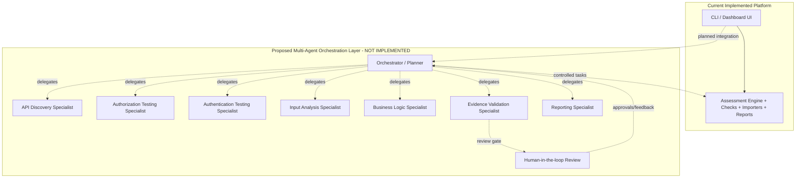

# Future Roadmap (Proposed / Not Implemented)

> **Status**: All items in this document are **proposed future architecture** unless explicitly marked otherwise. They are **not implemented** in the current repository and must not be treated as existing behavior.

## 1. Separation from current architecture

The current implemented system (see `SYSTEM_ARCHITECTURE.md`) provides:
- CLI and local dashboard API + React SPA
- Config-driven and passive-import-driven assessment workflows
- Scope/safety enforcement, discovery, bounded HTTP execution
- Implemented API security checks (API1–API10 behaviors with prerequisite-dependent execution)
- File-based evidence/findings/audit/report artifacts

The roadmap below describes potential extensions to evolve the platform toward a richer, multi-agent-assisted workflow.

## 2. Proposed future architecture (conceptual)

## 3. Proposed components and intent

| Proposed component | Intended role | Current status | Dependencies/prerequisites (if pursued) |
|---|---|---|---|
| Multi-agent orchestration | Coordinate specialized agents, task planning, and controlled execution | Not implemented (only minimal `Mission`/routing utilities exist) | Clear task contracts, safety/approval integration, auditable agent actions |
| API discovery specialist | Expand endpoint/schema discovery and inventory reconciliation | Not implemented as autonomous agent | Integration with `discovery.py`/importers and scope controls |
| Authorization testing specialist | Deepen BOLA/BFLA/BOPLA scenario generation within explicit authorization | Not implemented | Strong identity/case modeling, human approval, evidence standards |
| Authentication testing specialist | Structured authn/session/token analysis under supplied credentials | Not implemented | Explicit credential/session inputs, non-destructive test bounds |
| Input analysis specialist | Analyze parameters/payload surfaces for safe, scoped test planning | Not implemented | Schema-aware input modeling, policy constraints, guardrails |
| Business logic specialist | Model multi-step workflows and abuse cases from configured flows | Not implemented | Rich flow definitions, replay safeguards, operator review |
| Evidence validation specialist | Validate evidence quality, reproducibility, and false-positive reduction | Not implemented | Standardized evidence schemas, verification workflows |
| Reporting specialist | Generate higher-quality narratives and remediation guidance from verified evidence | Not implemented | Trusted finding/evidence inputs, template/governance rules |
| Human-in-the-loop review | Approval/review gates for risky actions and finding publication | Not implemented (no approval workflow in runtime path) | UI/CLI review states, audit trail, policy enforcement |

## 4. Integration opportunities with existing code (future, non-binding)

- **`bugbounty/specialists.py`** already defines a richer specialist catalog and ranking API; could serve as a basis for future orchestrated routing (currently unused by engine/CLI/dashboard).
- **`bugbounty/agents.py` and `bugbounty/orchestration.py`** provide minimal routing/mission primitives; would require significant expansion for production-grade orchestration.
- **`SecurityAppConfig.approval_mode` / audit fields** exist as configuration concepts but are not wired into the assessment engine’s execution path; future HITL/approval flows could leverage them.
- **Dashboard UX** could evolve to present agent plans, approvals, and evidence review states, but current UI is import/validate/run/results focused.

## 5. Non-goals and constraints for future work

- Do not weaken existing **scope, safety, dry-run, and request-boundary** controls.
- Do not treat specialist suggestions/routing as vulnerability confirmation; maintain evidence-first verification.
- Do not introduce autonomous active testing without explicit authorization and auditable controls.
- Preserve current CLI/config/report contracts where possible, or version changes explicitly.
