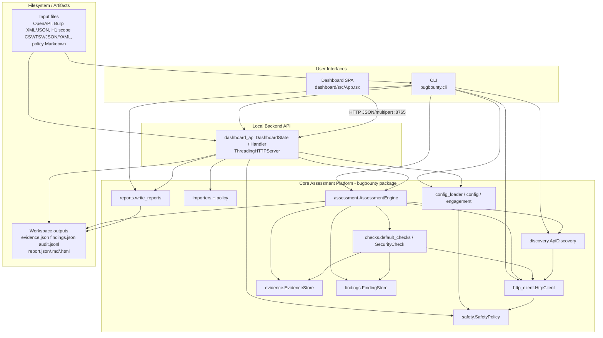
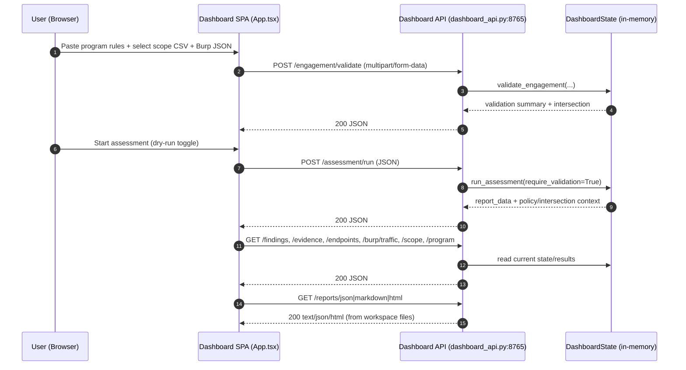
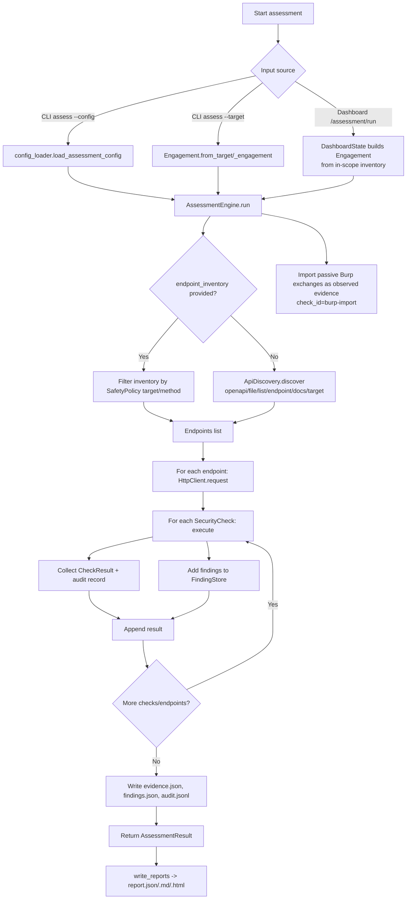
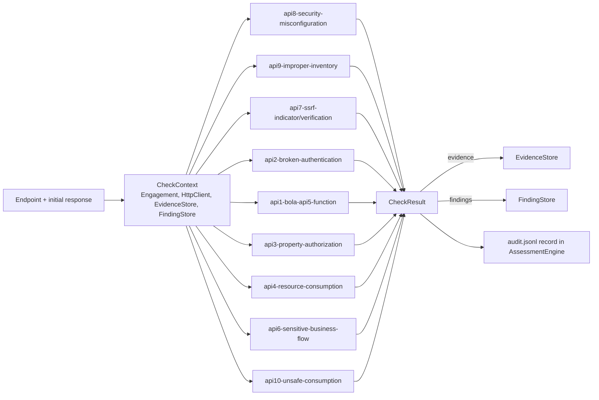
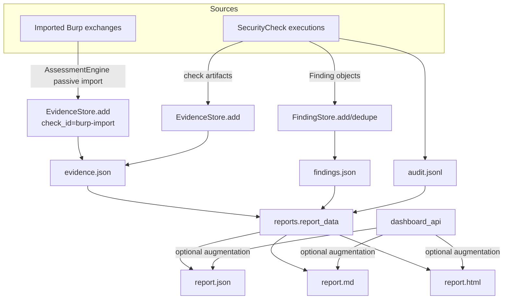
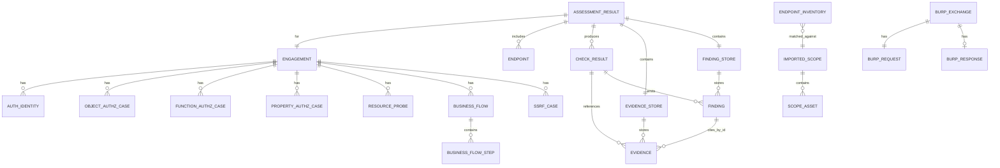

# System Architecture

> **Documentation basis**: Verified from source in `bugbounty/`, `dashboard/`, `examples/`, `tests/`, `pyproject.toml`, `README.md`, and existing `docs/architecture.md`.  
> **Rule**: Only implemented/verified components are diagrammed as current architecture. Proposed components are listed separately in `FUTURE_ROADMAP.md` and not merged into current diagrams.

## 1. Current high-level architecture

The repository implements a **local, scope-bounded API security assessment platform** with two primary user interfaces:
- **CLI** (`bugbounty.cli`) for workspace init/status, discovery, assessment (target/config), report path listing, and starting the dashboard API.
- **Dashboard**: a Python stdlib HTTP API (`bugbounty.dashboard_api`) plus a React/Vite SPA (`dashboard/`) for passive import, validation, scoped assessment execution, and report viewing.

Core runtime capabilities are centered on **engagement modeling**, **safety/scope enforcement**, **HTTP discovery and controlled requests**, **passive import normalization (HackerOne/Burp)**, **check execution/evidence/findings**, and **report generation**.

### 1.1 Component inventory (implemented)

| Layer | Component(s) | Primary files | Status |
|---|---|---|---|
| Frontend | React SPA (import/validate/run/results UI) | `dashboard/src/App.tsx`, `main.tsx`, `styles.css`, `index.html`, `vite.config.ts` | Implemented |
| Backend API (local) | Dashboard HTTP server/state | `bugbounty/dashboard_api.py` | Implemented |
| CLI | Command parsing and dispatch | `bugbounty/cli.py` | Implemented |
| Configuration | YAML/JSON assessment config loader; config models | `bugbounty/config_loader.py`, `config.py`, `engagement.py` | Implemented |
| Assessment engine | Orchestration of discovery/import, checks, artifacts | `bugbounty/assessment.py` | Implemented |
| Security checks | API1–API10-related checks and registry | `bugbounty/checks.py` | Implemented (prerequisite-dependent) |
| Scope/policy/safety | Engagement scope, safety decisions, program policy parsing | `bugbounty/engagement.py`, `safety.py`, `policy.py` | Implemented |
| Discovery | OpenAPI/manual/doc endpoint discovery | `bugbounty/discovery.py` | Implemented |
| HTTP client | Bounded/redacting request execution | `bugbounty/http_client.py` | Implemented |
| Importers | HackerOne/Burp parsing, redaction, scope intersection, inventory | `bugbounty/importers.py` | Implemented |
| Evidence & findings | Models, stores, dedupe, persistence | `bugbounty/evidence.py`, `findings.py` | Implemented |
| Reporting | JSON/Markdown/HTML report generation | `bugbounty/reports.py` | Implemented |
| Routing/orchestration utilities | Simple agent router and mission abstraction; specialist catalog/ranking | `bugbounty/agents.py`, `orchestration.py`, `specialists.py` | Implemented (utilities; not central to assessment execution) |
| Persistence | File-based workspace artifacts | Engine/report/dashboard writes to filesystem | Implemented (no DB) |

### 1.2 External integrations (as implemented)

- **No external SaaS integrations are invoked by runtime code**. Optional provider keys are documented in `.env.example`/`README.md`, but no provider client usage is present in `bugbounty/` source (verified).
- **Local file imports**: HackerOne scope files, Burp exports (JSON/XML), OpenAPI/spec files, program policy Markdown (dashboard paste or import endpoint).
- **Network targets**: User-authorized HTTP(S) targets accessed via `urllib` in `HttpClient` under scope/budget/dry-run controls.

## 2. Communication patterns

- **CLI → in-process modules**: `bugbounty.cli` directly instantiates/calls `AssessmentEngine`, `ApiDiscovery`, `HttpClient`, `Engagement`, `load_assessment_config`, `write_reports`, `serve_dashboard`.
- **Dashboard SPA → Dashboard API**: `dashboard/src/App.tsx` uses `fetch` to `http://127.0.0.1:8765` (JSON and multipart form-data). CORS allows origins `http://localhost:5173` and `http://127.0.0.1:5173`.
- **Dashboard API → core engine**: `DashboardState` parses/imports inputs, builds in-scope inventory/endpoints, constructs `Engagement`, selects checks (disables API4 if policy indicates DoS prohibited), runs `AssessmentEngine`, writes reports, and augments report context.
- **Assessment engine → subsystems**: engine uses `ApiDiscovery`/imported inventory + `HttpClient` + `checks` + `EvidenceStore`/`FindingStore`; writes `evidence.json`, `findings.json`, `audit.jsonl` to `engagement.workspace`.
- **Statefulness**: CLI runs are process-local. Dashboard API maintains **in-memory state** in `DashboardHandler.state` (`DashboardState`) shared across requests in the same server process.

## 3. Mermaid diagrams (current implementation)

### 3.1 High-level system architecture



### 3.2 Frontend-to-backend communication



### 3.3 Assessment execution flow



### 3.4 Scope validation flow (dashboard engagement validation)

```mermaid
flowchart TD
  A[POST /engagement/validate multipart] --> B{Required fields/files present?}
  B -->|No| X[400 ValueError]
  B -->|Yes| C[Parse program rules\npolicy.parse_program_markdown]
  C --> D[Parse HackerOne scope CSV\nimporters.parse_hackerone_scope]
  D --> E[Parse Burp JSON document\nimporters.parse_burp_json_document]
  E --> F[Build inventory\nbuild_inventory(exchanges, h1_scope, burp_scope)]
  F --> G[Compute intersection summary\nDashboardState.intersection_summary]
  G --> H[Set validation_complete=true\nstore context/state]
  H --> I[Return valid + program/scope/burp/intersection]
```

### 3.5 Security check execution



### 3.6 Evidence and reporting flow



### 3.7 Data model and relationships (implemented structures)



> **Note**: There is no relational database schema in the repository. The diagram represents in-memory/dataclass and serialized JSON relationships.

## 4. Architectural constraints observed

- **Local-first execution**: Dashboard server binds to host/port provided to CLI (default `127.0.0.1:8765`); frontend expects same host/port hardcoded.
- **Safety-first defaults in config examples**: `examples/engagement.yaml` sets `dry_run: true`; CLI `assess --target` defaults to dry-run in `_engagement` construction path (verified).
- **Passive import principle**: Burp observations are imported as evidence without replay (`AssessmentEngine.run` adds `burp-import` evidence with observation "Sanitized Burp observation imported without replay").
- **File-based artifacts**: Evidence/findings/audit/reports are written under the engagement/workspace directory; no database layer is implemented.
- **Partial integration of agent/specialist subsystems**: `agents.py`/`orchestration.py` and `specialists.py` provide routing/catalog capabilities but are not invoked by the assessment engine or CLI assessment flow (verified).
